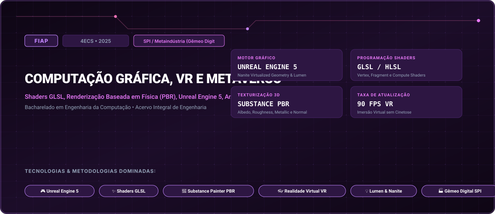

# FIAP • Computação Gráfica, VR e Metaverso (2025)

> **Engenharia da Computação — FIAP (Faculdade de Informática e Administração Paulista)**  
> **Turma:** 4ECS • Ano Letivo 2025  
> **Desafio Corporativo Integrado:** SPI / Metaindústria (Gêmeo Digital & Células Robóticas)  
> **Portal Interativo GitHub Pages:** [https://guimemee.github.io/fiap-computacao-grafica-vr-e-metaverso/](https://guimemee.github.io/fiap-computacao-grafica-vr-e-metaverso/)

---

## 📋 Sumário Executivo do Acervo

Este repositório consolida o acervo acadêmico integral e os projetos práticos de engenharia da disciplina **Computação Gráfica, VR e Metaverso**, contemplando:
1. **6 Checkpoints Oficiais (2025):** Enunciados integrais originais, memórias de cálculo passo a passo no padrão Symbolab e cadernos Jupyter (`.ipynb`) com gráficos executáveis.
2. **01_Apostilas_e_Teoria:** Livros didáticos, apostilas e slides de aulas.
3. **02_Exercicios_e_Laboratorios:** Listas práticas, scripts e códigos de laboratório.
4. **04_Global_Solution:** Desafios integradores semestrais da FIAP.
5. **05_Challenge_Sprints:** Sprints interdisciplinares de inovação corporativa (SPI / Metaindústria (Gêmeo Digital & Células Robóticas)).

---

## 🎯 6 Checkpoints Oficiais (2025)

- **Checkpoint 1:** Pipeline Gráfico Programável e Shaders GLSL (Vertex & Fragment) &rarr; [`03_Provas_Avaliativas_Checkpoints/Checkpoint_1_cp1/Resolucao_Calculos.ipynb`](03_Provas_Avaliativas_Checkpoints/Checkpoint_1_cp1/Resolucao_Calculos.ipynb)
- **Checkpoint 2:** Texturização PBR no Substance Painter e Mapeamento UV &rarr; [`03_Provas_Avaliativas_Checkpoints/Checkpoint_2_cp2/Resolucao_Calculos.ipynb`](03_Provas_Avaliativas_Checkpoints/Checkpoint_2_cp2/Resolucao_Calculos.ipynb)
- **Checkpoint 3:** Cenário Criativo e Gêmeo Digital na Unreal Engine 5 (Lumen & Nanite) &rarr; [`03_Provas_Avaliativas_Checkpoints/Checkpoint_3_cp3/Resolucao_Calculos.ipynb`](03_Provas_Avaliativas_Checkpoints/Checkpoint_3_cp3/Resolucao_Calculos.ipynb)
- **Checkpoint 4:** Física e Cinemática Direta/Inversa de Robôs na Unreal Engine &rarr; [`03_Provas_Avaliativas_Checkpoints/Checkpoint_4_cp4/Resolucao_Calculos.ipynb`](03_Provas_Avaliativas_Checkpoints/Checkpoint_4_cp4/Resolucao_Calculos.ipynb)
- **Checkpoint 5:** Interação em Realidade Virtual (VR) com OpenXR e Gestão de Cinetose &rarr; [`03_Provas_Avaliativas_Checkpoints/Checkpoint_5_cp5/Resolucao_Calculos.ipynb`](03_Provas_Avaliativas_Checkpoints/Checkpoint_5_cp5/Resolucao_Calculos.ipynb)
- **Checkpoint 6:** Integração do Metaverso Industrial com Gêmeos Digitais em Nuvem &rarr; [`03_Provas_Avaliativas_Checkpoints/Checkpoint_6_cp6/Resolucao_Calculos.ipynb`](03_Provas_Avaliativas_Checkpoints/Checkpoint_6_cp6/Resolucao_Calculos.ipynb)

---

## 🏛️ Créditos e Rastreabilidade
- **Instituição:** FIAP (Faculdade de Informática e Administração Paulista)
- **Curso:** Bacharelado em Engenharia da Computação
- **Turma:** 4ECS • Ano Letivo 2025
- **Aluno:** Guilherme Macário da Silva ([@Guimemee](https://github.com/Guimemee))
